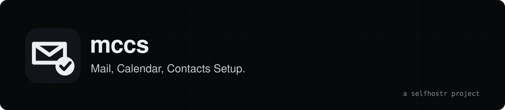

<div align="center">
<a href="https://mccs.selfhostr.io"></a>

**A white-label wizard that walks your users through setting up mail, calendar and contacts on their own devices.**

[Site](https://mccs.selfhostr.io) · [Docs](https://mccs.selfhostr.io/docs/) · [Releases](https://github.com/selfhostr/mccs/releases)

[](LICENSE)
</div>

## Overview

`mccs` (Mail, Calendar, Contacts Setup) is a web page you host for the customers of your mail service. They type their address, pick Windows, macOS, iPhone, iPad or Android, and get a short guide with every value ready to copy. It never asks for a password, stores nothing and sets no cookies. Free, for good: MIT licence, no paid edition.

## Quick start

```bash
git clone https://github.com/selfhostr/mccs.git && cd mccs
cp .env.example .env      # set MAIL_HOST, PUBLIC_URL, BRAND_NAME
docker compose up -d --build
```

Open http://localhost:8080 and try the wizard with an address on your domain. Nothing is stored on disk, so back up only your `.env`. For production, put it behind an HTTPS reverse proxy: see [docs/reverse-proxy.md](docs/reverse-proxy.md) and [docs/install.md](docs/install.md).

## Features

- **Guided wizard.** Address, device, app, then a step-by-step guide with copyable values.
- **Many apps.** Outlook (new and classic), CalDAV Synchronizer, Thunderbird, Apple Mail, Gmail, Samsung apps and DAVx5.
- **Apple and Thunderbird.** One-tap `.mobileconfig` profile (no password) and Thunderbird autoconfig.
- **Phone handoff.** QR code on a computer to continue on a phone.
- **Support page.** Internal `/support` (HTTP Basic) builds a link for one customer, with QR code and a ready-made email or SMS text.
- **White-label.** Name, logo, accent colour, servers and support contact come from environment variables.
- **Presets.** `mdaemon` (default) or `generic` (standard `.well-known` discovery), with URL templates to override either.
- **Light and dark.** Follows the system, mobile friendly, strict Content-Security-Policy.

## Architecture

One Node 22 process using only the built-in `http` module, with no npm dependency. The front end is plain HTML, CSS and JavaScript served from memory, and reads its settings from `/api/config`. Everything comes from environment variables, in a read-only container running as a non-root user. See [docs/](docs/index.md).

## Limits

- The interface and the guides are in French; translating means editing `public/js/guides.js`, `public/js/app.js` and the HTML files.
- The Apple profile is not signed, so iOS and macOS show "Not signed" when installing it.
- The guides describe third-party apps as they look today; a new app version can make a step out of date.
- It does not check that your mail server answers, and the `generic` preset has had less use than `mdaemon`.
- The `/support` lock-out keys on the `CF-Connecting-IP` header, so only expose the app behind a proxy that controls it.
- Early: variable names and endpoints can still change before 1.0. No published image, no automated tests and no CI yet.

## Contributing

Issues and pull requests are welcome: [CONTRIBUTING.md](CONTRIBUTING.md). Security issues: [SECURITY.md](SECURITY.md).

## License

MIT, see [LICENSE](LICENSE). Provided "as is", without warranty of any kind.

## Support

`mccs` is free and has no company behind it. If it saves you time: [sponsor us on GitHub](https://github.com/sponsors/selfhostr).
